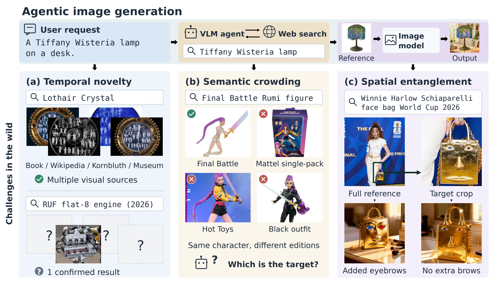
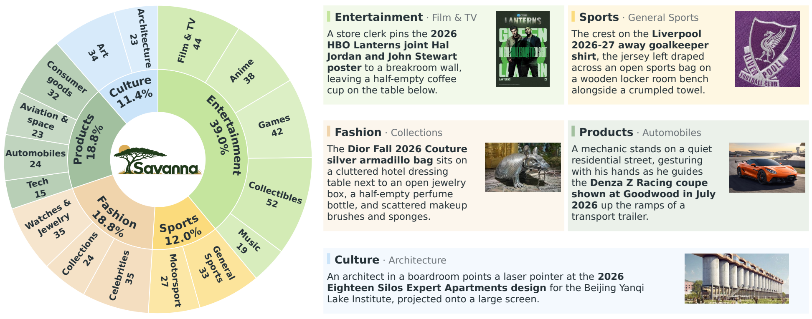
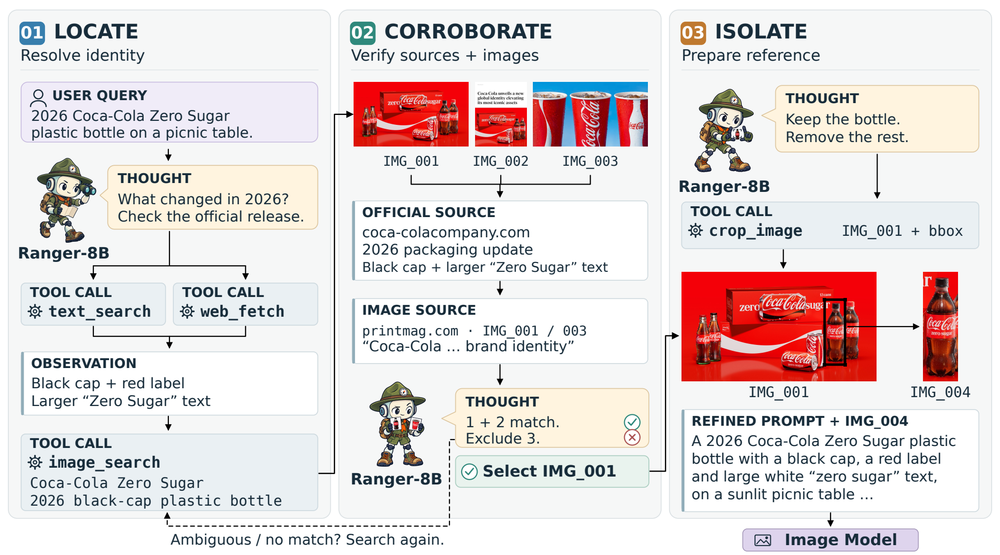

<div align="center">

# Agentic Image Generation in the Wild

[](https://arxiv.org/abs/2610.23269)

[**📖 Overview**](#overview) · [**🌿 Savanna Benchmark**](#savanna) · [**🔭 Ranger-8B**](#ranger) · [**📊 Results**](#results) · [**🖼️ Gallery**](#gallery) · [**📝 Citation**](#citation)

</div>

## 📢 News

- **[2026/10]** 📄 Paper is now available on [arXiv](https://arxiv.org/abs/2610.23269).
- **[Upcoming]** 🔓 Code, **Savanna** benchmark, **Ranger-15K** dataset, and **Ranger-8B** weights are undergoing internal open-source review and will be released here upon approval.

---

<a id="overview"></a>
## 📖 Overview

Agentic image generation equips image generators with web search agents to handle entities beyond their training data. Yet real-world requests often target entities that appeared only days ago—a setting we call **Image Generation in the Wild**, which poses three core challenges:

- **Temporal Novelty:** Newly introduced entities lack stable visual records on the web.
- **Semantic Crowding:** Search results are dominated by look-alike predecessors, competitors, or related entities.
- **Spatial Entanglement:** Target entities rarely appear in isolation, often mixed with other objects or cluttered backgrounds that mislead downstream generators.

<p align="center">
  
</p>

---

<a id="savanna"></a>
## 🌿 Savanna Benchmark

**Savanna** evaluates image generation in the wild with **500 prompts across 16 subcategories in 5 domains** (*Entertainment, Sports, Fashion, Products, Culture*):

- **Time-bounded & confusion-filtered:** Synthesized from July 2026 news headlines with search restricted to ≤ 3 days post-publication, retaining only targets with high retrieval confusion.
- **Human-verified:** Each sample provides a verified ground-truth reference and evaluation rubrics, independently checked by three annotators.
- **Challenging for frontier models:** Even the strongest frontier-model agent harness reaches only **51.5** in search accuracy, and end-to-end search-enabled generators peak at **34.9** in generation score.

<p align="center">
  
</p>

---

<a id="ranger"></a>
## 🔭 Ranger-8B

Built on `Qwen3-VL-8B-Instruct`, **Ranger-8B** follows the **Locate–Corroborate–Isolate** paradigm to deliver a grounded prompt and clean reference images to any downstream generator:

1. **Locate:** Pin down the target's exact identity via text search and webpage reading before querying images.
2. **Corroborate:** Cross-verify candidate images against gathered textual facts, source contexts, and each other.
3. **Isolate:** Crop the verified target to remove distracting objects and backgrounds.

**Ranger-8B** is trained on **Ranger-15K** (15,119 verified trajectories synthesized from Jan–Jun 2026 news, strictly prior to Savanna's evaluation window).

<p align="center">
  
</p>

---

<a id="results"></a>
## 📊 Results

### Performance on Savanna

Search score measures reference retrieval accuracy; generation score evaluates target identity and prompt fidelity across two downstream generators.

| Agent | Backbone | Search | Gen. (Qwen-Image-Edit-2511) | Gen. (Nano Banana Pro) |
| --- | --- | ---: | ---: | ---: |
| Mind-Brush | GPT-5.1 | 35.8 | 29.5 | 42.2 |
| GenEvolve | Qwen3-VL-8B | 37.5 | 34.2 | 42.7 |
| Gen-Searcher | Qwen3-VL-8B | 43.5 | 37.9 | 47.3 |
| GenClaw | Claude-Opus-5 | 49.8 | 36.5 | 46.4 |
| SCOPE | GPT-6-Astra | 51.5 | 37.3 | 47.6 |
| **Ranger-8B (Ours)** | **Qwen3-VL-8B** | **67.2** (+15.7) | **46.8** (+8.9) | **58.9** (+11.3) |

### Out-of-Domain Generalization

Using `Qwen-Image-Edit-2511` as the downstream generator, **Ranger-8B** transfers zero-shot to established benchmarks and outperforms prior agentic methods:

| Agent | Backbone | Mind-Bench (Overall) | KnowGen (K-Score) |
| --- | --- | ---: | ---: |
| Mind-Brush | GPT-5.1 | 15.8 | 16.74 |
| GenEvolve | Qwen3-VL-8B | 18.4 | 22.91 |
| Gen-Searcher | Qwen3-VL-8B | 19.8 | 26.35 |
| **Ranger-8B (Ours)** | **Qwen3-VL-8B** | **28.2** (+8.4) | **27.75** (+1.40) |

---

<a id="gallery"></a>
## 🖼️ Generation Gallery

Uncropped outputs generated by **Nano Banana Pro** conditioned on prompts and references retrieved by **Ranger-8B** across all five Savanna domains:

<p align="center">
  
</p>

---

<a id="citation"></a>
## 📝 Citation

```bibtex
@article{li2026agentic,
  title={Agentic Image Generation in the Wild},
  author={Li, Yifan and Qin, Bowen and Zhou, Kun and Zhao, Haochen and Liu, Zikang and Li, Zheng and Hao, Minsheng and Cheng, Yuhao and Zou, Haosheng and Chen, Jeff and Zhao, Wayne Xin},
  journal={arXiv preprint arXiv:2610.23269},
  year={2026}
}
```
